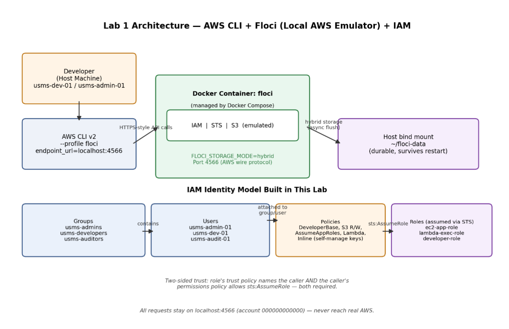

# DSO303 Lab 01 Report: IAM Foundation for USMS

## 1. Aim / Objective

The aim of this practical was to learn how AWS Identity and Access Management (IAM) works by creating and managing users, groups, policies, and roles using the AWS CLI. The lab also focused on testing permissions, protecting access keys, and verifying that the IAM configuration worked correctly.

## 2. Introduction

AWS Identity and Access Management (IAM) is used to control who can access AWS resources and what actions they are allowed to perform. IAM provides features such as users, groups, roles, and policies to manage permissions securely.

In this practical, IAM was explored using the AWS CLI with Floci as a local AWS environment. The lab covered creating users and groups, assigning permissions through policies, using roles, and testing access control.

## 3. Use Case

IAM is commonly used for:

- Managing employee accounts and access permissions.
- Giving developers access only to the AWS resources they need.
- Providing temporary access using IAM roles.
- Applying the principle of least privilege.
- Protecting sensitive AWS resources and credentials.

For example, in the USMS environment used in this lab, developers, auditors, and administrators can be placed into different groups and given different levels of access.

## 4. System Architecture / Design

The system used the AWS CLI to interact with the local Floci environment.



Users were assigned to groups, and permissions were managed mainly through policies attached to those groups. Roles were also created to provide temporary permissions through STS.

## 5. Implementation Procedure

### Step 1: Set up and verify Floci

Floci was checked to make sure Docker and the required environment were working correctly. The local AWS endpoint was also verified.

### Step 2: Configure persistent storage

Floci storage was configured so that IAM data could persist after restarting the environment. Persistence was later tested to confirm that the created resources remained available.

### Step 3: Configure IAM access

The AWS CLI was configured to use the `floci` profile so that commands were sent to the local Floci environment instead of the real AWS cloud.

### Step 4: Create IAM users and groups

Different IAM users and groups were created for the USMS environment. Users were then added to their appropriate groups.

### Step 5: Create and attach policies

AWS-managed and customer-managed policies were explored. A custom developer policy was created and attached to the required groups. Inline policies and policy versioning were also tested.

### Step 6: Create roles and instance profiles

IAM roles and trust policies were created. An instance profile was also created and connected to an EC2-related role.

### Step 7: Test role assumption

STS was used to assume a role and obtain temporary credentials.

### Step 8: Protect secrets

An access key file was checked to ensure that it was protected by file permissions and ignored by Git.

### Step 9: Verify the lab

The provided verification script was run to check the IAM resources and configuration.

### Step 10: Create a backup

The Floci snapshot command was attempted, but the installed version did not support the Snapshot API. Therefore, the filesystem backup method provided in the lab guide was used instead.

### Step 11: Commit the lab work

The completed lab files were added to the Git repository and committed.

## 6. Results and Evidence

### 6.1 CLI / SDK Output

The screenshots below show the main commands and successful results from the practical.

**Figure 1: Floci setup and verification**  

 

Shows the Floci environment being started and checked successfully.

**Figure 2: Floci environment check**

 

Shows the local Floci environment running and available for the lab.

**Figure 3: AWS identity verification**  


The `whoami` command was used to confirm the AWS CLI identity and connection.

**Figure 4: Isolation and persistence testing** 


The screenshots show that the IAM environment was isolated and that the configured data persisted after restarting Floci.

**Figure 5: IAM groups created**  


Shows the IAM groups created for the USMS environment.

**Figure 6: Users added to groups**  


Shows users and their group memberships.

**Figure 7: Customer-managed policy created and attached**


Shows the USMS developer policy attached to the required IAM groups.

**Figure 8: Locally created IAM policies**


Shows the customer-managed policies created during the lab.

**Figure 9: Inline policy configuration.**  


Shows the inline policy used for self-management of credentials.

**Figure 10: IAM policy versioning.**


Shows the updated policy version and its current attachment information.

**Figure 11: IAM role and trust policy configuration.**  


Shows the application role, its trust relationship, and attached permissions.

**Figure 12: CLI verification of the usms-ec2-app-profile instance profile and its associated IAM role.**  


Shows the instance profile created for the EC2 application role.

**Figure 13: STS assume-role result.**  


Shows temporary credentials returned after successfully assuming a role.

**Figure 14: Secret protection and Git ignore verification.**  


Shows that the access key file was protected and ignored by Git.

**Figure 15: Final Lab 01 verification.**


Shows the final verification script completing successfully with PASS = 34 and FAIL = 0.

### 6.2 AWS Management Console Verification

This practical used Floci as a local AWS environment, so the main verification was performed using the AWS CLI and the local console interface rather than the real AWS Management Console.


Shows the Floci local console and confirms that the local AWS environment was reachable.

## 7. Analysis and Discussion

The main objective of the practical was achieved successfully. IAM users, groups, policies, roles, and instance profiles were created and managed using the AWS CLI.

The results mostly matched the expected outcomes. The final verification script showed:

```text
PASS = 34
FAIL = 0
```

Some Floci features were not supported in the installed version. For example, `GetAccountAuthorizationDetails` and the Floci Snapshot API were unavailable. These were limitations of the local Floci environment rather than problems with the commands. The filesystem backup method provided in the lab was used as an alternative for the unsupported snapshot feature.

One important observation was how IAM policies affect access. Policies can allow or deny specific actions, and permissions can be managed more easily by assigning users to groups instead of configuring every user separately.

## 8. Reflection

### 1. What did you learn about this AWS service?

I learned how IAM manages access to AWS resources using users, groups, policies, and roles. I also learned the difference between managed policies, customer-managed policies, and inline policies.

### 2. What challenges did you encounter?

The main challenge was dealing with some unsupported features in the Floci environment, such as the Snapshot API. There were also some issues when testing permissions and understanding why certain actions were allowed or denied.

### 3. How would you apply this service in a real-world cloud environment?

IAM could be used to manage employees, developers, administrators, and other users by giving each group only the permissions they need. This would help improve security and follow the principle of least privilege.

### 4. What additional concepts would you like to explore?

I would like to learn more about IAM permission boundaries, multi-factor authentication (MFA), cross-account roles, and more advanced IAM policy conditions.

## 9. Conclusion

This practical successfully introduced the main concepts of AWS IAM. Users, groups, policies, roles, and instance profiles were created and managed using the AWS CLI in the Floci environment.

The lab also demonstrated the importance of controlling access, protecting credentials, and following the principle of least privilege. Despite some limitations in the Floci version, alternative methods were used and the final verification completed successfully with **34 checks passed and 0 failures**.

## 10. Appendix

The following materials are included as supporting evidence for this practical.

### Appendix A: Floci Setup and Verification

- Floci setup proof
- Floci environment verification
- Floci console UI

### Appendix B: IAM Configuration

- AWS identity verification
- IAM isolation proof
- IAM persistence proof
- IAM groups created
- Users added to groups

### Appendix C: IAM Policies

- Policy creation and attachment
- Locally created policy files
- Inline policy
- Policy versioning

### Appendix D: IAM Roles and STS

- Role and trust policy configuration
- Instance profile configuration
- STS assume-role result

### Appendix E: Security and Final Verification

- Secret and `.gitignore` proof
- Final `verify-lab-01.sh` result showing all checks passed

### Appendix F: Additional Evidence

- Intern user creation


Shows the creation of the additional intern IAM user.

- Intern user added to the auditors group


Shows the additional IAM user being added to the auditors group.

- Floci snapshot API error


Shows that the installed Floci version did not support the snapshot API.

- Filesystem snapshot backup created successfully


Shows the successful fallback backup created using the tar command.